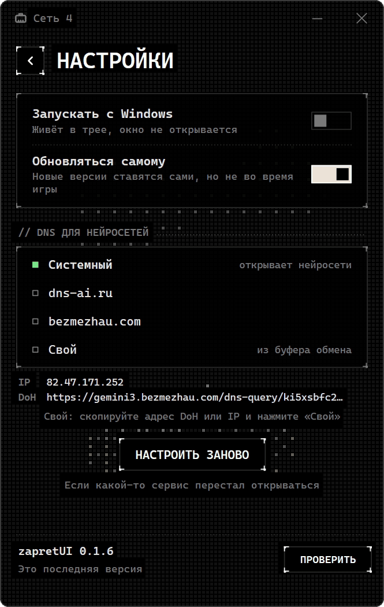
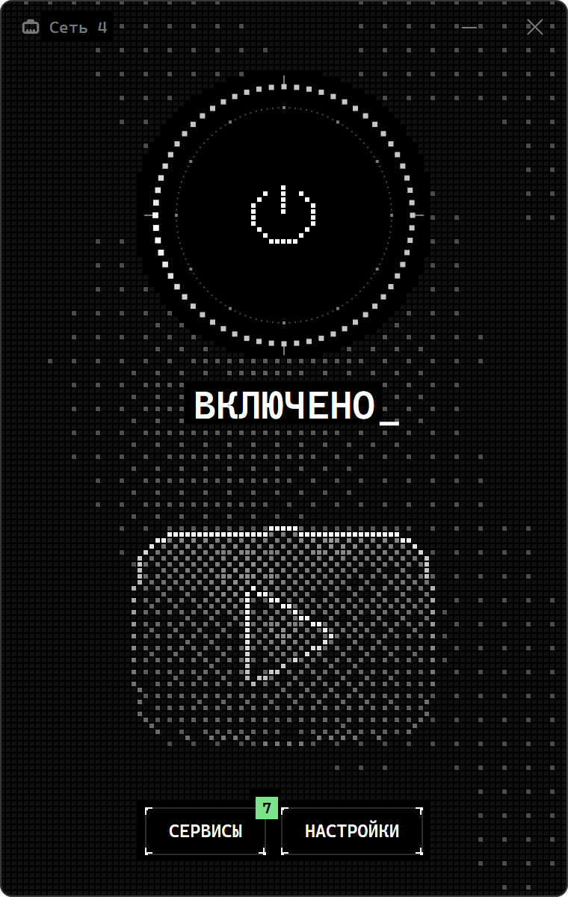
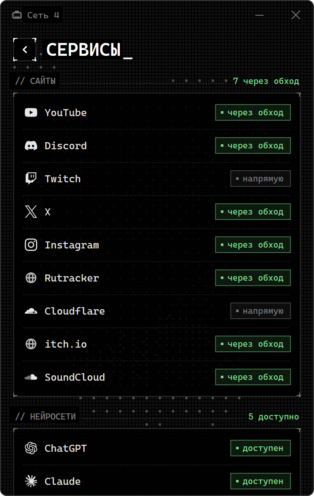
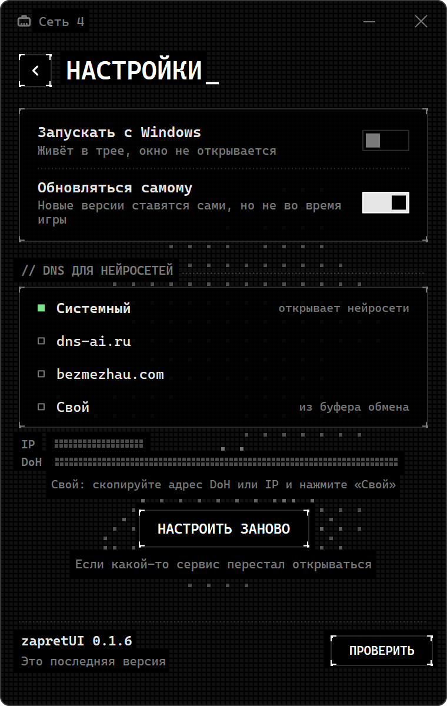
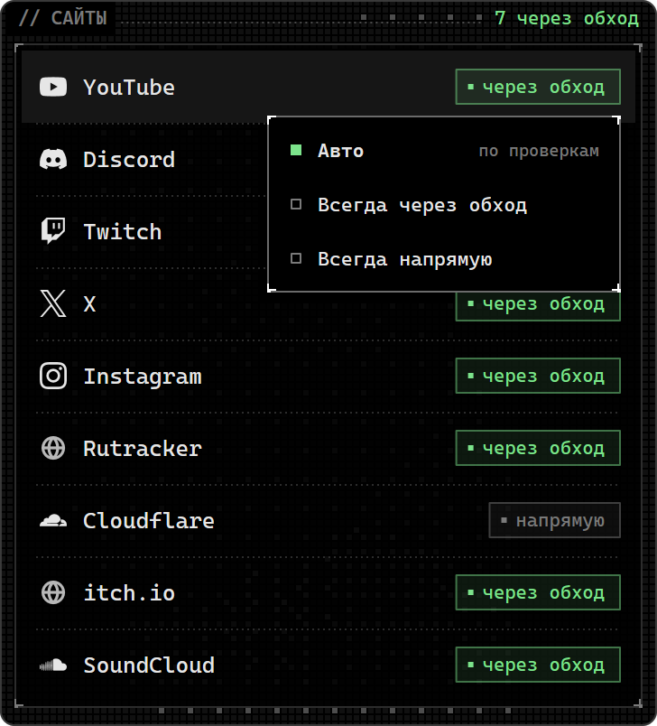

<div align="center">



# zapretUI

**Обход блокировок для Windows, который настраивается сам.**<br>
YouTube, Discord, Twitch, игры и лаунчеры: без батников, стратегий и консоли.

[](../../releases/latest)
[](../../releases)

[](LICENSE)

</div>

---

Обычно обход DPI выглядит так: скачать архив, перебрать десяток `.bat`-файлов и найти тот, что работает у вашего провайдера, а через неделю провайдер что-то поменял, и всё по новой.

zapretUI делает это за вас. Он сам проверяет, что и как режет ваш провайдер, перебирает способы обхода, выбирает самый быстрый из рабочих и запоминает его для этой сети. Если провайдер что-то поменяет, программа заметит это и подберёт способ заново.

## Как это выглядит

<table>
<tr>
<td align="center" width="33%"><br><sub><b>Главный</b>: одна кнопка, на бейдже число сервисов через обход</sub></td>
<td align="center" width="33%"><br><sub><b>Сервисы</b>: что открыто, что идёт через обход и почему</sub></td>
<td align="center" width="33%"><br><sub><b>Настройки</b>: автозапуск, обновления, DNS для нейросетей</sub></td>
</tr>
</table>

## Как это работает

| | Шаг | Что происходит |
|:-:|---|---|
| `01` | **Смотрит** | Проверяет каждый сервис по шагам: DNS, соединение, TLS, загрузку. Так видно, на каком шаге и как именно его режут. |
| `02` | **Подбирает** | Собирает варианты обхода из простых приёмов (`fake`, `multisplit`, `disorder` и других) и пробует их на настоящих сайтах. |
| `03` | **Перепроверяет** | Лучшие варианты гоняет ещё раз на всех сайтах и выбирает тот, что работает везде и отвечает быстрее. |
| `04` | **Следит** | Запоминает выбор для этой сети. Если сервис перестал открываться, программа сама переподбирает способ. |

Программа честно говорит, когда обход не поможет, вместо того чтобы молча не работать:

| Что видно в «Сервисах» | Что это значит |
|---|---|
| 🟢 `через обход` | Провайдер режет сервис, обход его открывает |
| ⚪ `напрямую` | Сервис и так открывается, программа его не трогает |
| 🟡 `режется` | Часть соединений режется, например загрузка обрывается на 16–20 КБ |
| 🔴 `не работает` | Сервис не открывается, и подобранный способ его пока не берёт |
| 🔴 `блок по IP` | Адрес закрыт целиком, обход DPI тут бессилен |
| 🔴 `подмена DNS` | Провайдер подменяет ответы DNS |
| 🔴 `закрыт для РФ` | Сервис сам не пускает пользователей из России |

Если оператор включил **белый список** и открываются только российские сайты, программа скажет об этом прямо: обход в таком режиме не поможет.



### Свой режим для сервиса

Нажмите на сервис, и откроется меню режима:

- **Авто**: решают проверки (по умолчанию);
- **Всегда через обход**: например, если у сервиса режутся звонки, а сайт открывается;
- **Всегда напрямую**: программа этот сервис не трогает.

Если что-то перестало открываться, нажмите «Настроить заново» в настройках.

<br clear="right">

## Что поддерживается

| Раздел | Сервисы |
|---|---|
| **Сайты** | YouTube, Discord, Twitch, X, Instagram, Rutracker, Cloudflare, itch.io, SoundCloud |
| **Хостинги** | Сайты на Linode, Vultr, Hetzner и OVH: если провайдер режет их на 16–20 КБ, через обход идут подсети хостинга целиком |
| **Нейросети** | ChatGPT, Claude, Gemini, Copilot, Cursor (см. ниже) |
| **Лаунчеры** | EA app, Ubisoft Connect |
| **Игры** | Roblox, Genshin Impact, Apex Legends, Rainbow Six Siege X |

Программа видит запущенные игры, помечает их «в игре» и не ставит обновления, пока вы играете.

## Нейросети

ChatGPT, Claude, Gemini, Copilot и Cursor провайдер не блокирует: они сами не пускают пользователей из России, и обход DPI тут не поможет. Их открывает специальный DNS. На имена нейросетей он отвечает адресом своего узла, а узел пересылает соединение дальше.

- В «Сервисах» у каждой нейросети видно, пускает ли она вас прямо сейчас: программа спрашивает у самого сервиса, из какой страны он вас видит.
- В настройках можно выбрать DNS: **Системный** (как в Windows), готовый (**dns-ai.ru**, **bezmezhau.com**) или **свой**. Для своего скопируйте адрес DoH (`https://…/dns-query`) или IP и нажмите «Свой».
- Через этот DNS идут только имена нейросетей, остальной DNS компьютера не меняется. Если такой DNS уже прописан в Windows, программа это увидит и ничего не тронет.

> [!NOTE]
> Узел DNS не видит содержимое (оно зашифровано до самого сервиса), но видит, к каким нейросетям и когда вы обращаетесь.

> [!TIP]
> Если в браузере включён свой «безопасный DNS» (DoH), он обходит эту настройку, поэтому выключите его. Проверить всё из командной строки: `zapretUI-svc ai`.

## Установка

Скачайте [последний релиз](../../releases/latest). Есть два варианта:

| | Установщик | Портативная версия |
|---|---|---|
| **Файл** | `zapretUI-setup-<версия>.exe` | `zapretUI-portable-<версия>.zip` |
| **Куда** | `C:\Program Files\zapretUI`, ярлык в «Пуске» | Любая папка, в систему ничего не ставится |
| **Права администратора** | Один раз, при установке | При каждом запуске (или один раз, если включить «Запускать с Windows») |
| **Удаление** | Через «Установленные приложения» | Удалить папку |

> [!WARNING]
> Держите портативную папку там, куда не пишут посторонние программы. С автозапуском Windows запускает `zapretUI.exe` из неё с правами администратора без запроса, и тот, кто подменит файл в папке, получит эти права. У установленной версии файлы защищены.

## Обновления

Программа сама проверяет новые версии и ставит их, когда вы не в игре. Автообновление можно выключить в настройках и обновляться кнопкой. Обновление ставится, только если оно подписано ключом проекта.

## Для разработчиков

<details>
<summary><b>Сборка</b></summary>

<br>

Нужны Rust 1.85+ и Windows SDK.

```sh
cargo build --release -p rkn-svc -p rkn-app
```

Файлы движка (`winws2.exe`, `cygwin1.dll`, `WinDivert.dll`, `WinDivert64.sys`, `lua/*.lua`) возьмите из релиза [zapret2](https://github.com/bol-van/zapret2) v1.0.7 и положите в `resources/winws2`. Их хеши сверяются с `resources/winws2/SHA256SUMS`.

</details>

<details>
<summary><b>Выпуск версии</b></summary>

<br>

1. Один раз: `cargo xtask keygen`. Закрытый ключ сохранится в `%USERPROFILE%\.zapretUI\release.key`; сделайте его копию.
2. Поднимите `version` в `Cargo.toml`.
3. `cargo xtask release --notes notes.md` соберёт установщик и портативный zip и опубликует релиз через `gh`. Программа внутри установщика подписана, автообновление берёт новую версию оттуда же. С `--dry-run` всё соберётся в `target/dist` без публикации.

</details>

<details>
<summary><b>Смена ключа подписи</b></summary>

<br>

Ключ один, и без него новые версии не подписать, поэтому храните копию `release.key` не на этом компьютере. Чтобы сменить ключ:

1. Добавьте новый открытый ключ в `accept` в `resources/release.toml` и выпустите версию, подписанную ещё старым ключом. Копии с этой версией примут обновления, подписанные любым из двух ключей.
2. Перенесите новый ключ в `key`, а старый оставьте в `accept`.

</details>

## Лицензии

zapretUI распространяется под лицензией [MIT](LICENSE). Внутри используются:

- [zapret2](https://github.com/bol-van/zapret2) (winws2 и скрипты Lua), MIT;
- [WinDivert](https://github.com/basil00/WinDivert), LGPL v3;
- Cygwin (`cygwin1.dll`), LGPL v3.

Спасибо [bol-van](https://github.com/bol-van) за zapret: без него этого проекта бы не было.
